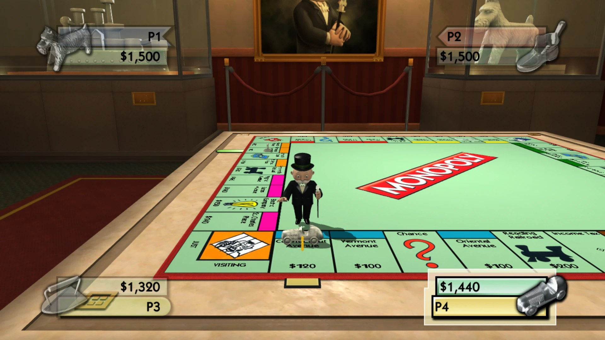
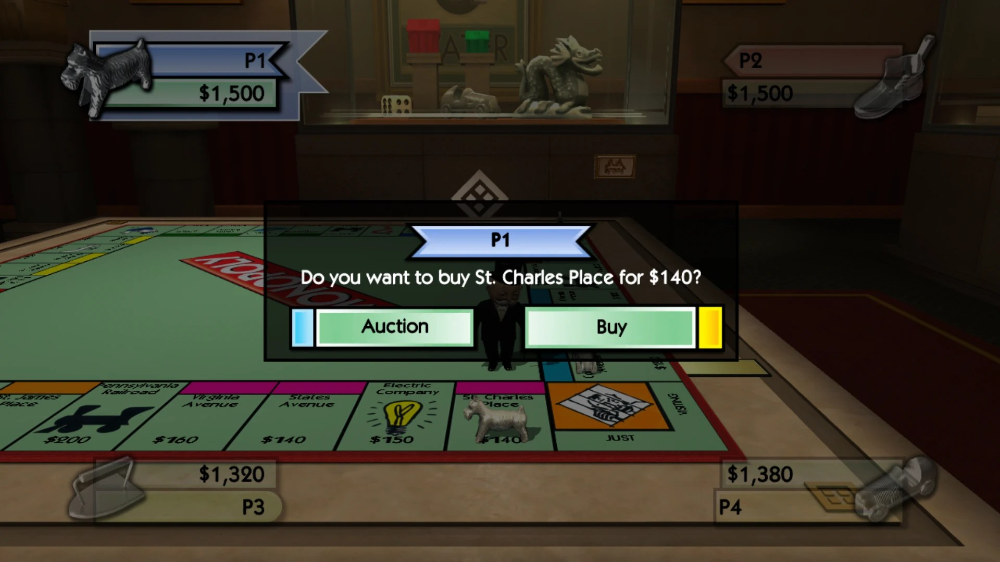
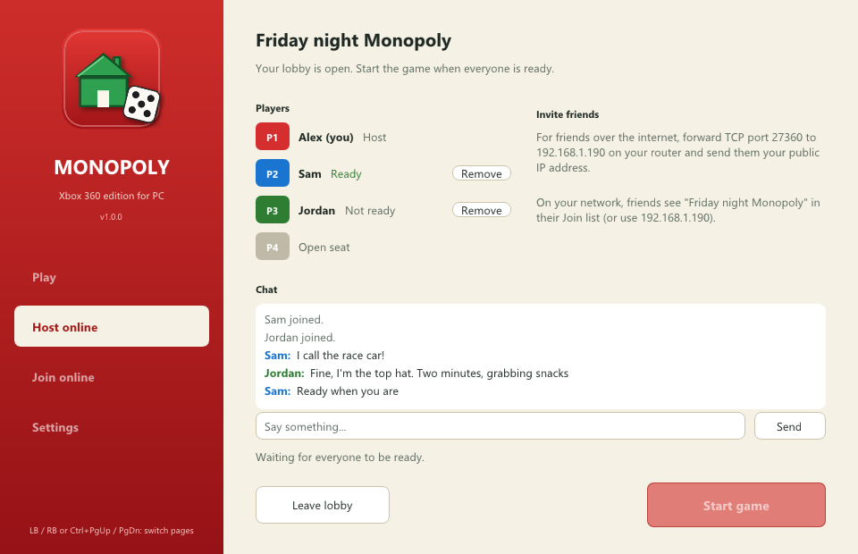
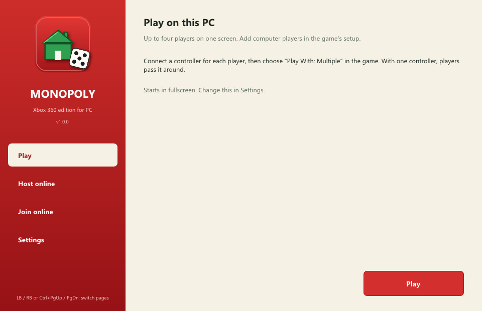

# Monopoly Recompiled

A statically recompiled PC port of **Monopoly** (Xbox 360, EA, 2008). The game's PowerPC code is translated ahead
of time to C++ with the [ReXGlue SDK](https://github.com/rexglue/rexglue-sdk) and compiled into a Windows program,
so there is no CPU emulator; the console's graphics, audio and system calls are reimplemented underneath, drawn
with Direct3D 12.



<p>
  
  
</p>

## Features

- **The whole game**: Monopoly Edition and Richest Edition, saves and the intro movies, at 60 fps
- **Up to four players on one PC**, each with their own controller
- **Online play for up to four**: the host runs the game and streams it to friends, who see and hear it and play
  with their own controller
- **Lobbies**: friends gather before the game, chat and ready up, and the host starts when everyone is in
  - Games on your home network show up by themselves
  - Friends over the internet join with a short code
  - The launcher asks your router to open the game's port (UPnP)
  - Optional public list, so anyone can find and join an open lobby
- **Rendering at 720p, 1440p or 4K** (2x and 3x are new and less tested)
- **Precompiled shaders** for the boards and menus played so far, so those screens don't stutter while shaders
  compile on first use
- **A launcher** that installs the game from your own disc image

**No game data is included**: the game's data and its original code are read from your own disc.

## Playing

You need **Windows 10 or 11 (64-bit)**, a graphics card with **Direct3D 12**, and your own dump of
**Monopoly for the Xbox 360 (USA, Europe)** as an `.iso` file.



1. Download the latest release and unzip it anywhere.
2. Open **`MonopolyLauncher.exe`**.
3. Press **Install from disc image...** and pick your `.iso`. The game files (about 1.9 GB) are copied into the
   `game` folder once; the image isn't needed afterwards. Already have the files? Use **Choose folder...**
   for a folder with `default.xex` and the `.big` files.
4. Press **Play**.

Plug in a controller for each player and choose **Play With: Multiple** in the game. **Settings** has fullscreen,
vertical sync and the rendering resolution. With a controller, LB / RB switch the launcher's pages.

## Playing online

**Host**: open **Host online**, then **Open lobby**. Share the join code it shows (for friends over the internet),
or just tell friends on your network to look in their Join list. When everyone is ready, press **Start game**.

**Friends**: open **Join online** and pick the game from **Public games** or **On your network**, or type the
code. Friends don't need the game files. They play with a controller, or with the keyboard:

| Keyboard | Controller |
|---|---|
| Arrow keys | D-pad |
| Enter or Z | A |
| Backspace or X | B |
| C / V | X / Y |
| Q / E | LB / RB |
| Space | Start |
| Esc | Back |

Friends over the internet need **TCP port 27360** open on the host's router. The launcher asks the router to
open it; if your router doesn't allow that, forward the port to your PC yourself. The host uploads about
4 Mbit/s of video and 1.5 Mbit/s of audio per friend.

### Public games

The **Public games** list comes from a small lobby server that everyone shares. It's included in the release as
`server/lobby_directory.py` (Python 3, nothing to install). Run it on any always-on machine reachable from the
internet:

```
python3 lobby_directory.py --port 27380
```

Then put its address (for example `http://your-server:27380`) in the launcher's **Settings**. Behind a reverse
proxy, add `--trust-proxy`. The server checks that each host can be reached from the internet before listing it.

## Building

See [docs/PREP.md](docs/PREP.md) for the full log. In short, with Visual Studio 2026 Build Tools, LLVM (clang-cl)
and Ninja:

1. Clone the ReXGlue SDK at the pinned commit into `rexglue-sdk/`, apply `patches/rexglue-codegen-fixes.patch`,
   and build and install it.
2. In `port/`, run `rexglue codegen monopoly_manifest.toml` against your own `default.xex`, then build the
   `win-amd64-release` preset.
3. At the top level, build the launcher, the join client and the tests with CMake and Ninja, then run
   `tools\package.ps1`.

## Credits

- [ReXGlue SDK](https://github.com/rexglue/rexglue-sdk) by Tom Clay, built on the [Xenia](https://xenia.jp)
  project's work
- [Dear ImGui](https://github.com/ocornut/imgui), [stb](https://github.com/nothings/stb), SDL and the other
  libraries listed in [THIRD_PARTY_NOTICES.txt](THIRD_PARTY_NOTICES.txt)

This port's own code is under the [GPL-3.0](LICENSE). It is a fan project, not affiliated with or endorsed by
Hasbro or Electronic Arts. MONOPOLY is a trademark of Hasbro. You need your own copy of the game.
